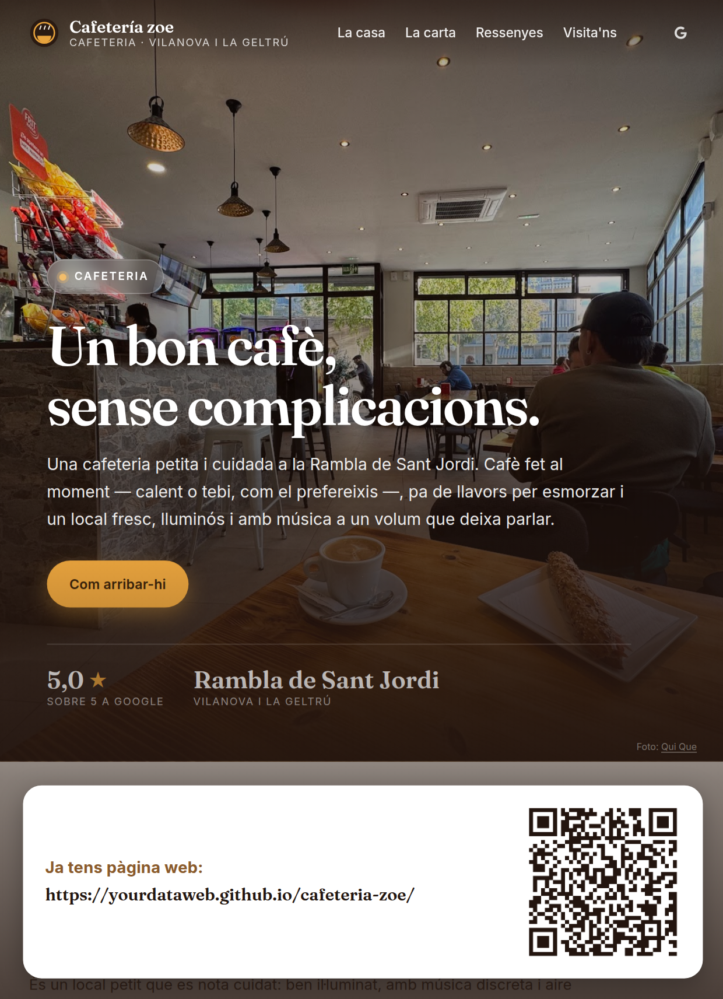

# Cafetería zoe

Trilingual static website for **Cafetería zoe**, a coffee shop on Rambla de Sant Jordi, Vilanova i la Geltrú (Barcelona).

**Live (Català, default):** https://yourdataweb.github.io/cafeteria-zoe/
**Español:** https://yourdataweb.github.io/cafeteria-zoe/es/
**English:** https://yourdataweb.github.io/cafeteria-zoe/en/

Hand-written HTML, CSS and vanilla JS with a small dependency-free build step. No framework, no runtime dependencies, no client-side rendering.

---

## Project identity

| Field | Value |
|---|---|
| Code name | `cafeteria-zoe` |
| Domain label | `cafeteria-zoe` |
| Repository | `cafeteria-zoe` |
| S3 prefix | `cafeteria-zoe/` |

Lowercase ASCII, hyphen-separated, no edge hyphens — valid as an RFC 1123 DNS label (≤63 chars), a GitHub repository name and an S3 bucket prefix.

## Structure

```
.
├── src/
│   ├── template.html          # single HTML template with {{i18n}} holes
│   ├── place.json             # business data (edit here)
│   └── i18n/
│       ├── ca.json            # Catalan (default)
│       ├── es.json            # Spanish
│       └── en.json            # English
├── index.html                 # GENERATED — Catalan (default)
├── es/index.html              # GENERATED — Spanish
├── ca/index.html              # GENERATED — redirect to /
├── en/index.html              # GENERATED — English
├── assets/
│   ├── css/styles.css
│   ├── js/app.js              # behaviour only; content is in the HTML
│   └── photos/                # hero photo, SVG artwork, og.png, touch icon
├── scripts/
│   ├── build.mjs              # renders every locale
│   ├── make-icons.mjs         # og.png + apple-touch-icon.png
│   ├── verify.mjs             # headless functional assertions
│   └── audit-layout.mjs       # geometry, contrast, touch-target audit
└── .github/workflows/pages.yml
```

## Build

```bash
node scripts/build.mjs
```

Emits `index.html`, `ca/index.html`, `en/index.html`, `sitemap.xml`,
`manifest.webmanifest` and `robots.txt`. The build **fails** if any `{{hole}}`
or `<!--MARKER-->` survives into the output.

Every locale is real server-rendered HTML — not a JS language swap. Each has its
own `<html lang>`, canonical URL, `og:locale`, and a reciprocal `hreflang` set
for all three languages plus `x-default`.

## Content model

All business content lives in `src/place.json`; UI strings live in
`src/i18n/{es,ca,en}.json`. The template only holds markup and markers, so
changing a fact or a sentence never requires touching HTML.

Optional fields degrade cleanly: if a value is absent, the corresponding block
is not rendered rather than being emitted empty. No placeholder or dead link is
ever shipped.

## Cookies and consent

The site sets no advertising or tracking cookies. It stores one
`localStorage` key (`cookie-consent-v1`) recording that the visitor accepted the
notice. The Google Maps iframe is gated behind that consent: the embed URL sits
in `data-src` and is only promoted to `src` once the visitor accepts, so no
third-party request is made before consent. A small inline script in `<head>`
applies the accepted state before first paint, so returning visitors never see
the notice flash.

The map is reachable without consent through the "Google Maps" link, which is a
plain navigation, not an embed.

## Verification

```bash
node scripts/build.mjs
python3 -m http.server 8100 &
BASE=http://127.0.0.1:8100/ node scripts/verify.mjs
BASE=http://127.0.0.1:8100/ node scripts/audit-layout.mjs
```

`verify.mjs` asserts, per locale: exactly one `h1`, no heading-level jumps,
canonical + 4 `hreflang` links, one active language, testimonials present,
**zero** `tel:` links, **zero** `wa.me` links, no floating WhatsApp button, the
rating badge for a 5.0 rating, the review count hidden under 50, parseable
`CafeOrCoffeeShop` JSON-LD with **no invented telephone**, an `output=embed`
map, no published hours or prices, and no horizontal overflow.

`audit-layout.mjs` measures 3 locales × 5 viewports for overflow, clipped text,
touch targets and WCAG contrast.

## Screenshot for the owner



```bash
node scripts/screenshot.mjs
```

Produces `assets/photos/handover.png`: **1240 × 1713 px at 300 dpi**, i.e.
**10.5 × 14.5 cm** printed. The resolution is written into the PNG (`pHYs`
chunk), so image viewers and print dialogs report the physical size instead of
guessing 72 dpi.

The image shows the page top with an overlay: a QR code pointing at the live
URL, bottom-right, and the caption *"Ja tens pàgina web:
https://yourdataweb.github.io/cafeteria-zoe/"* beside it.

The page renders at 820 CSS px so the card shows the tablet layout (nav bar
visible) rather than the phone layout the site switches to at 780 px and below.
The device pixel ratio is derived from the target width, so the output lands on
the exact print size without resampling.

When printing, use **100 % / actual size**, not "fit to page".

## Deploy

Push to `main`; the workflow builds and deploys. First-time setup:
**Settings → Pages → Source: GitHub Actions**.

## Accessibility and SEO

- Semantic landmarks, one `h1` per page, no heading-level jumps
- Skip link, visible focus rings, ≥44 px touch targets
- Colour pairs checked against WCAG AA in `audit-layout.mjs`
- `CafeOrCoffeeShop` JSON-LD per locale, canonical + `hreflang` set, Open Graph and
  Twitter cards, `sitemap.xml`, `robots.txt`
- Every `` has an `alt`; decorative ones use `alt=""`

## Third-party content

Review text and reviewer avatars belong to their authors. The map embed is
served by Google Maps.
